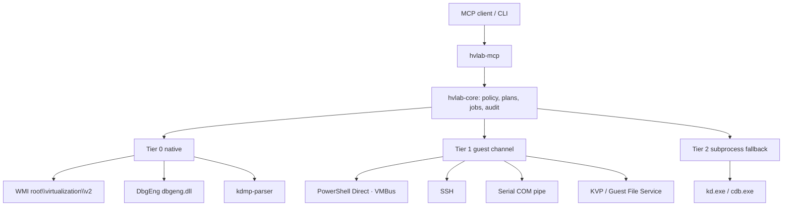

# hvlab — open-source Hyper-V control plane for agents and humans

**Status:** design plan, pre-implementation
**Date:** 2026-10-23
**License:** MIT OR Apache-2.0

---

## 0. What this is

`hvlab` is an open-source Hyper-V management server. It speaks the Model Context Protocol so an AI agent can drive a Hyper-V host, and it ships the same engine as a normal CLI so a human or a CI job can drive it without an LLM in the loop.

The problem it solves: Hyper-V's real capability is spread across four unrelated surfaces — the Hyper-V WMI provider, PowerShell Direct, DbgEng, and a pile of PowerShell cmdlets — with different auth models, different failure modes, and no shared vocabulary. An agent asked to "boot the VM, run this, and tell me why it crashed" has to stitch all four together by hand, and every project that tries re-implements the same plumbing and re-discovers the same traps.

`hvlab` is that plumbing, done once, with a typed contract, a safety model, and tests.

### 0.1 Who it is for

| Audience | What they get |
|---|---|
| **Kernel / driver developers** | VM lifecycle, KDNET/COM attach, live debugging, crash-dump triage, checkpoint rollback — from an agent or a script |
| **Security researchers / malware analysts** | Disposable VM snapshots, guest execution over VMBus with no guest networking, dump extraction, serial capture of early boot |
| **CI / test infrastructure** | Deterministic VM provisioning, artifact staging, guest command execution with real exit codes, per-test checkpoint restore |
| **Homelab and small-fleet operators** | Inventory, health, storage cleanup, bulk power operations, NAT/switch management |
| **Educators and demo authors** | Scripted lab environments that reset to a known state |
| **AI agent authors** | A Hyper-V tool surface that is schema-typed, cancellable, and safe by default instead of 400 raw cmdlet wrappers |

### 0.2 Design principles

1. **Universal, not project-specific.** No vendor workflows, no product-specific recipes, no hardcoded assumptions about what runs inside the guest. Anything workload-specific is a *recipe the user writes*, not a tool we ship.
2. **Windows and Linux guests are both first-class.** PowerShell Direct is one channel among several, not the model.
3. **Native first.** WMI and DbgEng in-process. Subprocesses only where no API exists, and always in a killable job object.
4. **Bounded everything.** Every queue, buffer, and timeout has an explicit capacity and an explicit overflow policy.
5. **Fail loudly and typed.** No `ok: false` in a success-shaped payload. One error channel, stable machine-readable codes.
6. **Destructive means planned.** Irreversible operations require a digest-bound plan token, not a boolean.
7. **The CLI is not a second-class citizen.** Everything the MCP exposes is reachable from `hvlab <noun> <verb>`, and is tested that way.
8. **Boring where it matters.** No clever abstractions over COM. No custom IPC where a documented one exists.
9. **No opinions in the data.** The server reports what it observes and what Microsoft documents. It does not tell you whether a crash is important, whether a VM is "healthy", or whether a setting is "correct" — those depend on your system, and you know it better than a tool does.

### 0.3 Name

`hyperv-mcp` is already used by two live projects (`originsec/hyperv-mcp` in Python; `RestrictedWTF/hyper-v-mcp-rs` in Rust). A third identical name fragments search results and guarantees confused issue reports. `hvlab` is free on crates.io and GitHub, and reads as a tool rather than a protocol binding.

```
hvlab mcp                       # MCP server (stdio default; --transport http)
hvlab vm list|get|start|stop    # same engine, human- and CI-friendly
hvlab guest exec --vm X -- cmd  # run a command in a guest
hvlab dump inspect|analyze      # offline crash-dump triage
hvlab kd attach|break|cmd       # live kernel debugging
hvlab console attach            # serial / console stream
hvlab doctor                    # environment + capability probe
```

The crate `keywords` include `mcp`, `hyperv`, `virtualization`, `vm`, `kernel-debugging`; the README title is "hvlab — Hyper-V MCP server & CLI" so discovery is unaffected by the name choice.

### 0.4 Three workflows this must nail

Everything else is detail. If these three are not excellent, the project has no reason to exist.

**1. Run a command in a guest and get a real answer.**

```
hv_guest_ping    { vm: "build-01" }            → { ps_direct: true, ssh: false, serial: true }
hv_guest_exec    { vm: "build-01",
                   program: "C:\\tools\\build.exe",
                   args: ["--release"], cwd: "C:\\src",
                   timeout_s: 600 }
                 → { exit_code: 0, stdout: "...", stderr: "", truncated: false,
                     duration_ms: 41230, channel: "ps_direct" }
```

The contract that matters: the exit code is the program's, not the transport's; stdout and stderr are separate; truncation is declared, not silent; a timeout kills the process tree and says so; and the same call works over SSH on a Linux guest without changing anything but the channel.

**2. Attach a kernel debugger and inspect a running target.**

```
hv_kd_configure  { vm: "lab-01", transport: "kdnet", host_ip: "auto" }
                 → { attach_string: "net:port=50000,key=a1b2c.d3e4f.5a6b7.c8d9e",
                     reboot_required: true, secure_boot_disabled: true }
hv_vm_restart    { vm: "lab-01" }
hv_kd_attach     { attach_string: "...", timeout_s: 120 }
                 → { attached: true, broken_in: true, target: "Windows 11 26100" }
hv_kd_cmd        { command: "!analyze -v" }        → { output: "...", truncated: false }
hv_kd_registers  {}                                 → { rip: "0xfffff802...", cr3: "0x1a000" }
hv_kd_stack      { frames: 20 }                     → { frames: [{ symbol: "nt!KeBugCheckEx+0x0", ... }] }
hv_kd_breakpoint { action: "add", expression: "nt!NtCreateFile" }
hv_kd_continue   {}
```

The contract that matters: attach either succeeds with evidence (a break event) or fails with a reason; commands never hang forever because the target is running — the session reports `target_running: true` instead of burning a timeout; and break/step are real operations on the engine, not keystrokes sent to a console.

**3. Find out why a machine crashed.**

```
hv_dump_find     { newest: 1 }        → { dumps: [{ path: "C:\\Windows\\MEMORY.DMP",
                                                  size: 2147483648, bugcheck: "0x0000009F" }] }
hv_dump_inspect  { path: "..." }      → { bugcheck: 0x9F, params: [...], dump_kind: "kernel",
                                          build: "26100.1.amd64fre", uptime_s: 8123 }   # < 5 ms
hv_dump_analyze  { path: "...", symbols: true }
                 → { bugcheck: { code: 0x9F, name: "DRIVER_POWER_STATE_FAILURE",
                                 doc: "https://learn.microsoft.com/..." },
                     faulting_module: "mydriver.sys",
                     stack: [...], modules: [...], symbol_status: "resolved",
                     raw_log: "...", cached: false }
hv_dump_compare  { a: "before.dmp", b: "after.dmp" }
                 → { bugcheck_changed: false, modules_added: ["mydriver.sys"], stack_diff: [...] }
```

The contract that matters: the bugcheck is available in microseconds from the header, before any symbol work; the code is translated to its documented name and linked to Microsoft's page; the faulting module is named; and the server never editorializes about whether the crash is expected.

### 0.5 Getting started (target UX)

```powershell
# install
cargo install hvlab            # or: winget install hvlab / scoop install hvlab

# is this machine ready?
hvlab doctor
#   [ok]   Hyper-V role enabled
#   [ok]   vmms service running
#   [ok]   member of Hyper-V Administrators
#   [ok]   dbgeng.dll found: C:\Program Files (x86)\Windows Kits\10\Debuggers\x64
#   [warn] symbol cache empty — first symbol load will download
#   [ok]   2 VMs visible

# register with an MCP host (stdio)
hvlab mcp --print-config      # emits the JSON block to paste into your host config

# or run it directly
hvlab mcp
```

Minimal config, all optional:

```toml
[guest]
username = "Administrator"
password_env = "HVLAB_GUEST_PASSWORD"
ssh_user = "lab"
ssh_key  = "C:\Users\me\.ssh\id_ed25519"
```

```powershell
$env:HVLAB_GUEST_PASSWORD = "..."
```

Then, from any MCP client:

```
hv_capabilities {}                                  # what can this host do?
hv_vm_list {}
hv_guest_exec { vm: "dev-01", program: "cmd.exe", args: ["/c", "ver"] }
```

Five minutes from install to first guest command, with no PowerShell module, no Python, and no elevation beyond the Hyper-V Administrators group.

---

## 1. Scope

### 1.1 In scope (v1.0)

| Area | Capability |
|---|---|
| **Host** | Inventory, capability probe, versions, NUMA, resources, event log, services, storage roots |
| **VM lifecycle** | Create, import, export, clone, register, delete, start, stop (graceful/save/turnoff), reset, pause, resume, wait-for-state |
| **VM configuration** | Memory, CPU, firmware, secure boot, TPM, shielding, video, COM, integration services, affinity, nested virtualization |
| **Devices** | Disks, DVDs/ISOs, NICs, add/remove/attach |
| **Storage** | VHD/VHDX create, convert, resize, compact, mount, QoS, VHD sets |
| **Networking** | Switches (external/internal/private/NAT), NIC connect, VLAN, MAC, bandwidth, ACLs, guest IP discovery |
| **Checkpoints** | Standard/production/disk-only, restore, delete subtree, export, apply, compare |
| **Guest execution** | PowerShell Direct, SSH, serial console, KVP, Guest File Service — with real exit codes |
| **Guest inspection** | Processes, services, registry, files, event log, users, scheduled tasks, OS info |
| **Crash dumps** | Find, fast-header inspect, full DbgEng analysis, modules, threads, stacks, memory, compare, collect-from-guest |
| **Live kernel debugging** | KDNET and COM/pipe attach, break, step, registers, symbols, memory, breakpoints, command packs |
| **Orchestration** | Wait-for-ready, crash recovery, soak runner, watchdog |
| **Artifacts** | Content-addressed staging, SHA-verified transfer, loopback HTTP for guest pull |

**Every capability in the table is reachable both as an MCP tool and as a CLI verb**, with the same schema and the same result. There is no "agent-only" path and no "script-only" path.

### 1.2 Out of scope (v1.0), with reasons

| Not doing | Why |
|---|---|
| Hyper-V Manager GUI replacement | Different product; the API surface is the goal |
| Multi-hypervisor (VMware/KVM/Proxmox) | Abstraction over incompatible models produces a lowest-common-denominator API; separate projects are better |
| Remote host management | WMI over DCOM and remote PS Direct have a different trust and latency model; v2 |
| Live migration / storage migration orchestration | Requires cluster or shared-storage context; v2 |
| Replica / failover clustering | Enterprise-specific lifecycle; v2 |
| Guest agents we install | We use OS-provided channels (VMBus, SSH, serial). Shipping an agent is a security and maintenance commitment |
| VM provisioning from ISOs (unattended install) | Distribution-specific; belongs in user recipes |
| Windows-specific product workflows | Recipes, not tools |

### 1.3 Compatibility

| Host | Status |
|---|---|
| Windows 11 Pro/Enterprise (Hyper-V enabled) | Primary target |
| Windows 10 1809+ Pro/Enterprise | Supported; feature-probed |
| Windows Server 2016 / 2019 / 2022 / 2025 | Supported; feature-probed |
| Windows Server Core | Supported (no GUI dependency anywhere) |
| Windows in a VM with nested virtualization | Supported; VM-inside-VM caveats documented |

| Guest | Channel used |
|---|---|
| Windows 10/11, Server 2016+ | PowerShell Direct (VMBus), Guest File Service, KVP, heartbeat |
| Windows 7/8.1, Server 2008 R2/2012 | KVP, heartbeat, serial; SSH if installed. **No PS Direct** (needs 10/2016+) |
| Linux (any distro with `hv_*` drivers) | SSH, serial console, KVP (`hv_kvp_daemon`), Guest File Service (`hv_fcopy_daemon`) |
| BSD / other | Serial console, SSH if installed |

Every capability is probed at runtime and reported by `hv_capabilities`; nothing is assumed from an OS version string.

---

## 2. Prior art and the gap

Three public projects already target this space. All are useful; none covers the whole surface.

| Project | Stack | Does well | Leaves open |
|---|---|---|---|
| `originsec/hyperv-mcp` | Python, 19 tools | PS Direct guest exec, KDNET/KDCOM configuration returning an attach string, unprivileged-account execution | No crash dumps, no live debugging, no storage or network surface, no checkpoint tree; one subprocess per call |
| `RestrictedWTF/hyper-v-mcp-rs` | Rust, ~400 cmdlet wrappers | Broad cmdlet coverage, typed schemas, persistent PowerShell sidecar, DPAPI credential store | Everything is a cmdlet wrapper; no dump analysis, no live debugging, no guest channel besides PS Direct; requires elevation |
| `sandraschi/virtualization-mcp` | Python | Multi-hypervisor breadth | Breadth over depth; no kernel-debugging or dump story |

The gap is a single engine covering **lifecycle + guest channels + crash dumps + live kernel debugging** together, on native APIs rather than cmdlet wrappers, with a safety model that survives unattended use and a tool surface a homelab user can read.

A second, less visible gap: none of them is designed for **non-Windows guests**. PowerShell Direct is Windows-only and needs a running Windows 10/2016+ guest. Linux guests — the majority of homelab and CI workloads — need SSH or serial, and Linux is where most people first meet a VM that never boots. This project treats Linux as a first-class guest OS from day one (§4.2, Appendix A).

---

## 3. Verified dependency stack

All versions checked against crates.io on 2026-10-23.

### 3.1 Core

| Crate | Version | Role | Notes |
|---|---|---|---|
| `rmcp` | 3.7.0 | MCP server/client | Targets spec `2026-07-28`; `task_manager` module implements the Tasks extension; features `server`, `macros`, `schemars`, `transport-io`, `transport-streamable-http-server` |
| `tokio` | 1.54.1 | async runtime | `rt-multi-thread`, `process`, `sync`, `time`, `signal` |
| `windows` | 0.62.2 | Win32 bindings | Features listed in §3.3 |
| `schemars` | 1.2.3 | JSON Schema derive | one struct → input schema, output schema, and docs |
| `serde` / `serde_json` | 1.0.229 / 1.0.154 | wire format | |
| `clap` | 4.6.7 | CLI | derive + `completion` |
| `figment` | 0.10.19 | layered config | TOML + env + CLI, precedence testable |
| `thiserror` | 2.0.21 | error enums | typed taxonomy |
| `tracing` + `tracing-subscriber` | 0.1.44 | structured logs | JSON to stderr + rotating file; **never stdout** (stdio transport owns it) |
| `tokio-util` | 0.7.20 | `CancellationToken` | cooperative cancellation |
| `uuid` | 1.29.0 | identifiers | |
| `time` | 0.3.55 | timestamps | |
| `secrecy` + `zeroize` | 0.10.3 / 1.9.1 | secret handling | `SecretString` whose `Debug` prints `***` |
| `bytes` / `futures` | 1.12.1 / 0.3.34 | streaming | chunked output |

### 3.2 Backends

| Crate | Version | Role | Notes |
|---|---|---|---|
| `wmi` | 0.18.4 | Hyper-V WMI v2 | `WMIConnection::{with_namespace_path, raw_query, get_object, exec_instance_method, exec_class_method, put_instance, delete_instance, associators}`; `!Send + !Sync` → one connection per worker thread |
| `dbgeng` | 0.5.1 | DbgEng convenience layer | commands, registers, memory, symbols, typed reads over an `IUnknown`; `!Send + !Sync` → one thread per session |
| `kdmp-parser` | 0.8.2 | Kernel dump headers | `Header64::{bug_check_code, bug_check_code_parameters}`; no dependencies |
| `russh` | 0.64.1 | SSH client for Linux/legacy guests | pure Rust, async |
| `win32job` | 2.0.3 | Job objects | kill process trees |
| `dashmap` / `parking_lot` | 6.2.1 / 0.13.0 | concurrent maps, locks | actor registry |

### 3.3 `windows` feature set

`Win32_Foundation`, `Win32_System_Com`, `Win32_System_Wmi`, `Win32_System_Threading`, `Win32_System_JobObjects`, `Win32_System_Registry`, `Win32_System_IO`, `Win32_System_Diagnostics_Debug`, `Win32_System_Diagnostics_Debug_Extensions`, `Win32_Storage_Vhd`, `Win32_NetworkManagement_IpHelper`, `Win32_NetworkManagement_NetManagement`, `Win32_Security`.

Deliberately **not** enabled: `Win32_System_HostComputeSystem` — see §4.2.

DbgEng interfaces live under `windows::Win32::System::Diagnostics::Debug::Extensions`: `DebugCreate`, `IDebugClient`…`IDebugClient8`, `IDebugControl`…`IDebugControl4`, `IDebugSymbols`…`IDebugSymbols5`, `IDebugSystemObjects`…`IDebugSystemObjects4`, `IDebugDataSpaces`, `IDebugRegisters`, `IDebugBreakpoint`, `DebugBaseEventCallbacks`.

### 3.4 Optional / feature-gated

| Feature | Adds | Default |
|---|---|---|
| `ssh` | `russh` guest channel | on |
| `external-debugger` | `kd.exe`/`cdb.exe` adapters when `dbgeng.dll` is absent | off |
| `ps-fallback` | read-only PowerShell sidecar when WMI is unavailable | off |
| `http` | streamable HTTP transport | on |
| `vendored-dbgeng` | never — licensing forbids redistribution; feature does not exist | n/a |

---

## 4. Architecture

### 4.1 Crates

```
hvlab/                          workspace
├─ crates/
│  ├─ hvlab/                    binary: `hvlab` (mcp | vm | guest | dump | kd | console | doctor)
│  ├─ hvlab-mcp/                rmcp server, tool registry, schemas, transports, profiles
│  ├─ hvlab-core/               ids, errors, config, policy, plan tokens, audit, job store
│  ├─ hvlab-host/               WMI v2: VMs, devices, storage, networking, host facts, KVP
│  ├─ hvlab-guest/              guest channel abstraction: PS Direct, SSH, serial, KVP, file service
│  ├─ hvlab-debug/              DbgEng: dump analysis, live KD, symbols, cache
│  ├─ hvlab-dump/               kdmp-parser fast path + `!analyze` text parser (pure Rust, no FFI)
│  ├─ hvlab-recipe/             user-defined TOML recipes + parser registry
│  └─ hvlab-testkit/            fake backends, fault injection, MCP client harness, fixtures
├─ docs/                        ADRs, generated tool reference, operations guide, recipes
├─ benches/                     criterion suites
├─ tests/{hermetic,simulated,host,live}/
└─ .github/workflows/
```

Rules: `hvlab-mcp` depends on `hvlab-core` + backends; backends never depend on `hvlab-mcp`. `hvlab-dump` is pure Rust so taxonomy and header parsing test on Linux CI. `hvlab-guest` exposes a `GuestChannel` trait so a new channel (SSH, serial, agent) is additive.

### 4.2 Tiers



**Tier 0 — native.** No child processes. WMI v2 is the management plane; DbgEng handles dumps and live KD in-process; `kdmp-parser` gives microsecond bugcheck extraction.

> **Why not HCS.** `HcsOpenComputeSystem` / `HcsEnumerateComputeSystems` address *HCS compute systems* — containers, WSL2 utility VMs, and VMs created by `HcsCreateComputeSystem`. A VM created by `New-VM`, Hyper-V Manager, or WMI is generally **not** an HCS compute system. An HCS-based fast path would enumerate zero VMs on a normal host. HCS has no public checkpoint API either. It is therefore not used in v1; a future `hcs-owned-vms` feature can manage VMs that `hvlab` itself created through HCS.

**Tier 1 — guest channels.** A trait with four implementations, chosen by capability probe rather than by OS guesswork:

| Channel | Transport | Guests | Gives |
|---|---|---|---|
| PowerShell Direct | VMBus (`Invoke-Command -VMName`) | Windows 10/2016+ | Full PowerShell, files, services, registry |
| SSH | TCP via guest NIC | Any with sshd | Command exec, SFTP, POSIX semantics |
| Serial console | Host named pipe ↔ virtual UART | Any (Gen1 COM; Gen2 COM supported but hidden) | Early boot, kernel panic, bootloader, no credentials |
| KVP / heartbeat / Guest File Service | VMBus integration services | Any with `hv_*` / `vmic*` | IP discovery, liveness, host→guest file copy |

The persistent-session pattern is used for PS Direct (`New-PSSession -VMName` + `Invoke-Command -Session`), which Microsoft documents as the way to avoid per-command session setup. One sidecar `powershell.exe` speaks a length-prefixed JSON protocol and holds one session per VM.

**Tier 2 — subprocess fallback.** `kd.exe`/`cdb.exe` when `dbgeng.dll` is missing or a specific extension only works in the real debugger. Opt-in, reported by `hv_doctor`.

### 4.3 Concurrency

- **Per-VM actor.** Every mutating operation for a VM goes through that VM's mailbox. Prevents interleaved start/stop/checkpoint.
- **WMI thread affinity.** `WMIConnection` is `!Send + !Sync`. A fixed pool of `min(4, cores/2)` threads each own a connection; no connect-per-call.
- **DbgEng thread affinity.** Each debug session owns one thread and one `IDebugClient`. All engine calls are messages to that thread — the only way `SetInterrupt` and cancellation work.
- **Guest channel pool.** One PS Direct session per VM (configurable), one SSH connection per VM, multiplexed commands.
- **Limits.** `max_concurrent_tools` (8), `max_concurrent_guest_ops` (2/VM), `max_open_debug_sessions` (2). Excess queues with a deadline, then `hv.busy`.
- **Cancellation.** Every long op takes a `CancellationToken` wired to MCP cancellation and `tasks/cancel`. WMI jobs are abandoned after the deadline; PS Direct sends `Stop-Job` (never `-Force`, which hangs on Windows PowerShell 5.1); DbgEng calls `SetInterrupt(DEBUG_INTERRUPT_EXIT)`.

### 4.4 Protocol decisions

| Decision | Choice | Why |
|---|---|---|
| Spec version | `2026-07-28` via `rmcp` 3.7 | Stateless core, Tasks extension for long ops |
| Transports | stdio (default), streamable HTTP (opt-in) | Desktop hosts vs CI/remote |
| Long operations | Tasks extension + job store | Dump analysis with symbols, VM boots, soaks can exceed any sane request timeout |
| Output | `outputSchema` + `structuredContent` on every tool | One struct derives schema, docs, and serialization — no drift |
| Errors | MCP tool error + typed `code` | Stable machine-readable failure classes |
| Tool surface | **Profiles** (§4.7) | A homelab user should not see 200 tools |
| Resources | 9 URIs (§4.5) | Read-only inventory without burning tool calls |
| Prompts | 5 workflows (§4.5) | Encode multi-step procedures |

### 4.5 Resources and prompts

| Resource | Contents |
|---|---|
| `hvlab://host` | host name, OS build, Hyper-V version, capability flags |
| `hvlab://vms` | all VMs: id, name, state, generation, version, uptime, IPs |
| `hvlab://vm/{id}` | full detail: config, devices, integration services, checkpoints, jobs |
| `hvlab://dumps` | discovered dumps with size, mtime, and bugcheck from the fast header path |
| `hvlab://dump/{id}` | cached analysis summary |
| `hvlab://bugchecks` | **public** catalog: code → symbolic name, short description, Microsoft doc link |
| `hvlab://jobs`, `hvlab://job/{id}` | job state and progress |
| `hvlab://events` | host event ring buffer with a monotonic `seq` cursor |
| `hvlab://config`, `hvlab://audit` | effective config (secrets redacted), audit tail |

`hvlab://vm/{id}` is keyed by the WMI `Msvm_ComputerSystem.Name` GUID, never the display name, so a rename cannot silently retarget a cached plan or a subscription.

`hvlab://bugchecks` is generated from **public Microsoft documentation** (bugcheck code reference). It contains code, symbolic name, one-line meaning, and a documentation URL. It contains **no** project-specific interpretation, no "this class is closed", no opinion about whether a crash is interesting. Interpretation is the agent's job; the server supplies facts.

| Prompt | Steps |
|---|---|
| `triage-crash` | find dump → `hv_dump_inspect` → `hv_dump_analyze` → summarize with evidence and symbol status |
| `attach-debugger` | probe KD capability → configure KDNET or COM → return attach string → attach → verify break-in |
| `boot-and-run` | start VM → `hv_wait_ready` → run command → collect output → optional checkpoint restore |
| `deploy-and-verify` | publish artifact → SHA verify → transfer → remote SHA verify → execute smoke check |
| `reset-environment` | plan restore → confirm → `hv_wait_ready` → report state |

### 4.6 Data model

```rust
pub struct VmId(pub Uuid);        // Msvm_ComputerSystem.Name
pub struct JobId(pub Uuid);
pub struct PlanId(pub Uuid);

pub enum VmState { Off, Starting, Running, Paused, Saving, Stopping, Saved, Unknown(u16) }

pub struct Job {
    pub id: JobId, pub kind: JobKind, pub target: Option<VmId>,
    pub state: JobState, pub phase: Option<String>, pub percent: Option<u8>,
    pub started: SystemTime, pub deadline: Option<SystemTime>,
    pub result: Option<serde_json::Value>, pub error: Option<HvError>,
}

pub struct Plan {
    pub id: PlanId, pub digest: [u8; 32], pub tool: String,
    pub target: Option<VmId>, pub steps: Vec<PlanStep>,
    pub expires_at: SystemTime, pub policy_revision: u64,
}

pub struct HvError {
    pub code: ErrorCode, pub message: String, pub retryable: bool,
    pub context: serde_json::Map<String, Value>,
    pub correlation_id: Uuid, pub partial: Option<Value>,
}
```

`VmState` decodes `Msvm_ComputerSystem.EnabledState` through one table, preserving `Unknown(u16)` rather than collapsing to a default — a wrong default silently turns "paused" into "off". The exact numeric mapping is pinned by a fixture recorded from a live host in M0, because the CIM state enumeration and Hyper-V's actual usage differ at several values.

The plan digest is `SHA-256(canonical_json(tool, args, target, policy_revision))`; canonicalization sorts keys, normalizes paths, and lowercases GUIDs. Identical requests produce identical digests, so a retry after a transport error is safe; any argument change invalidates the token.

### 4.7 Tool profiles

200 tools is too many for a homelab user and too few for a power user if we cut them. Profiles solve this without a second binary:

| Profile | Size | Audience |
|---|---|---|
| `core` (default) | ~60 | Homelab, CI, first-time agent use — lifecycle, guest exec, dumps, KD, checkpoints, health |
| `full` | 200 (exact registry size) | Power users, researchers; `--tools full` or `[server] profile = "full"` |
| `readonly` | every class-`R` tool | Monitoring, dashboards, read-only agent deployments |
| custom | any | `--tools core,dumps,kd` or a TOML list |

The active profile is reported in `hv_capabilities` and in `serverInfo.instructions`, so an agent knows what it cannot see. Switching profiles is a restart, not a runtime mutation — a tool appearing mid-session would invalidate cached plans.

Profile membership is declared per tool in the registry (`profiles: &["core"]`), so sizes are *derived*, never hand-maintained: a test asserts `full` equals the registry size and `readonly` equals the count of class-`R` tools. Adding a tool without deciding its profile fails CI.

---

## 5. Tool catalogue

> **Status:** this catalogue is the full v1.0 design target (200 tools).
> The shipped server registers **40** of them: all of §5.2 host facts
> (minus policy), §5.3 VM lifecycle and §5.4 configuration subsets,
> §5.5 storage, §5.6 switch/NIC basics, §5.7 checkpoints, five of §5.8
> guest execution, §5.11 dump inspect/find/analyze, and meta
> capabilities/plan/tools-list. Guest inspection (§5.9), console and
> serial (§5.10), live kernel debugging (§5.12), orchestration (§5.13),
> artifacts (§5.14), and recipes (§5.15) are **not implemented**, and
> the `policy` layer of §7.1 is not built (destructive calls are gated
> by plan tokens only). Per-group counts below describe the target, not
> the current build; run `hvlab tools` for the live list.

Safety classes: **R** read-only · **M** mutating, reversible · **D** destructive, needs a plan token · **X** arbitrary code execution in guest, needs a plan token and `policy.mode = "admin"`.

### 5.1 Meta / diagnostics (12)

| Tool | Class | Notes |
|---|---|---|
| `hv_capabilities` | R | active profile, tiers, feature flags, WMI/DbgEng/Hyper-V versions, protocol version |
| `hv_doctor` | R | per-check status + remediation; `--fix` variant is class M |
| `hv_config_get` | R | effective config, secrets as `is_set` |
| `hv_config_validate` | R | parse errors, unknown keys, effective values |
| `hv_config_reload` | M | reload from disk, returns new `config_revision` |
| `hv_plan` | R | produce a plan token for any `D`/`X` call |
| `hv_metrics` | R | tool latency percentiles, queue depth, error counts by code |
| `hv_logs_tail` | R | structured log tail, bounded |
| `hv_task_list` / `hv_task_get` / `hv_task_cancel` | R/M | task and job inspection |
| `hv_audit_tail` | R | append-only audit records |

### 5.2 Host (12)

`hv_host_info`, `hv_host_versions` (supported + default VM configuration versions), `hv_host_numa`, `hv_host_resources` (CPU/memory/storage pressure), `hv_host_eventlog`, `hv_host_services` (`vmms`, `vmic*`), `hv_host_time`, `hv_host_storage_roots` (default VHD/VM paths), `hv_host_default_switch`, `hv_host_features` (what this build supports), `hv_host_policy_get`, `hv_host_policy_set`.

### 5.3 VM lifecycle (21)

`hv_vm_list`, `hv_vm_get`, `hv_vm_create`, `hv_vm_import`, `hv_vm_compat_report` (the equivalent of `Compare-VM`: what would fail on this host and why, before anything is written), `hv_vm_export`, `hv_vm_clone`, `hv_vm_register`, `hv_vm_unregister`, `hv_vm_delete`, `hv_vm_rename`, `hv_vm_start`, `hv_vm_stop` (`shutdown|save|turnoff`), `hv_vm_restart`, `hv_vm_reset`, `hv_vm_pause`, `hv_vm_resume`, `hv_vm_save`, `hv_vm_wait_state`, `hv_vm_set_autostart`, `hv_vm_update_version`.

`hv_vm_stop` polls `Msvm_ConcreteJob` and `EnabledState` to a terminal state within a caller deadline, rather than sleeping a fixed interval and reporting whatever it sees. `hv_vm_update_version` warns when the target version will prevent the VM from starting on older hosts.

### 5.4 VM configuration (18)

`hv_vm_get_config`, `hv_vm_set_memory`, `hv_vm_set_dynamic_memory`, `hv_vm_set_processor`, `hv_vm_set_firmware`, `hv_vm_set_secure_boot` (templates: `MicrosoftWindows`, `MicrosoftUEFICertificateAuthority`, `OpenSourceShieldedVM`, `None`), `hv_vm_set_tpm`, `hv_vm_set_security` (shielding, encryption), `hv_vm_set_video`, `hv_vm_set_com`, `hv_vm_set_integration_service`, `hv_vm_set_heartbeat`, `hv_vm_set_boot_order`, `hv_vm_set_affinity`, `hv_vm_set_numa`, `hv_vm_set_nested_virtualization`, `hv_vm_set_resource_metering`, `hv_vm_set_notes`.

Every setter takes a `dry_run` and returns a diff of what would change.

### 5.5 Devices and storage (17)

`hv_device_add_disk`, `hv_device_remove_disk`, `hv_device_add_dvd`, `hv_device_set_iso`, `hv_device_add_nic`, `hv_device_remove_nic`, `hv_vhd_list`, `hv_vhd_get`, `hv_vhd_inspect` (format, virtual and physical size, block size, parent chain, and which VMs currently hold it), `hv_vhd_create`, `hv_vhd_convert`, `hv_vhd_resize`, `hv_vhd_compact`, `hv_vhd_mount`, `hv_vhd_dismount`, `hv_vhd_optimize`, `hv_vhd_set_qos`.

`hv_vhd_mount` exposes a VHDX as a host volume for offline repair or file extraction — genuinely useful, genuinely dangerous, class D.

### 5.6 Networking (16)

`hv_switch_list`, `hv_switch_get`, `hv_switch_create` (`external|internal|private|nat`), `hv_switch_remove`, `hv_switch_set`, `hv_nic_list`, `hv_nic_connect`, `hv_nic_disconnect`, `hv_nic_set_vlan`, `hv_nic_set_mac`, `hv_nic_set_bandwidth`, `hv_nic_set_acl`, `hv_nat_list`, `hv_nat_add`, `hv_nat_remove`, `hv_net_guest_ips` (KVP + `Msvm_GuestNetworkAdapterConfiguration`, with staleness noted).

### 5.7 Checkpoints (10)

`hv_checkpoint_list`, `hv_checkpoint_tree`, `hv_checkpoint_get`, `hv_checkpoint_create` (`standard|production|disk_only`), `hv_checkpoint_restore`, `hv_checkpoint_delete` (`include_subtree`), `hv_checkpoint_rename`, `hv_checkpoint_export`, `hv_checkpoint_apply`, `hv_checkpoint_compare`.

Implementation: `Msvm_VirtualSystemSnapshotService::CreateSnapshot` with `SnapshotType` 2 (full) or 3 (disk-only) and `ConsistencyLevel` 1 (application-consistent) or 2 (crash-consistent). Return `4096` means an async job — poll `Msvm_ConcreteJob.JobState` until `7` (completed) or `8/9/10` (failed), then verify VM state independently, because completed jobs are retained only about five minutes and a vanished job is not a failure.

### 5.8 Guest execution (22)

| Tool | Class | Channel |
|---|---|---|
| `hv_guest_ping` | R | all — reports which channels are live |
| `hv_guest_exec` | X | PS Direct or SSH; argv form, no shell |
| `hv_guest_powershell` | X | PS Direct only |
| `hv_guest_shell` | X | SSH only; POSIX argv, no shell |
| `hv_guest_spawn` | X | detached process with redirected logs; optional `stdin_pipe` for tools that read input; returns job handle |
| `hv_guest_job_status` | R | alive, exit code, log tail |
| `hv_guest_job_log` | R | bounded log read with cursor |
| `hv_guest_job_kill` | M | kill by job id or pid |
| `hv_guest_session_open` / `hv_guest_session_list` / `hv_guest_session_close` | M/R/M | explicit session lifecycle for stateful work |
| `hv_guest_put` / `hv_guest_get` | M | SHA-256 verified both sides |
| `hv_guest_read_file` / `hv_guest_write_file` | R/M | small files, base64, explicit truncation |
| `hv_guest_list_dir` | R | entries with size and time |
| `hv_guest_delete` | D | root-allowlisted |
| `hv_guest_screenshot` | R | guest-side capture, returned as an MCP image block |
| `hv_guest_reboot` | D | graceful then forced, with wait |
| `hv_guest_autologon` | D | Winlogon autologon; password never echoed |
| `hv_guest_kdnet` / `hv_guest_kdcom` | D | `bcdedit` configuration, returns an attach string |

**Identity assertion before execution.** Any channel that can fall back to the local machine must prove where it is before running the payload. PS Direct's failure mode is that `Invoke-Command -VMName` can error in a way that leaves a job with no remote location, and code that only inspects the result *afterwards* cannot prevent damage. `hvlab` sends a per-session nonce as the first statement; the guest echoes `HVLAB-IDENT <nonce> <hostname>`, and the host refuses to write the payload until that line arrives with the correct nonce and expected hostname. This is a general guard against a general class of bug, not a response to one crash code.

### 5.9 Guest inspection (17)

`hv_guest_os_info`, `hv_guest_process_list`, `hv_guest_process_kill`, `hv_guest_service_list`, `hv_guest_service_control`, `hv_guest_registry_read`, `hv_guest_registry_write`, `hv_guest_network_config`, `hv_guest_disk_usage`, `hv_guest_eventlog`, `hv_guest_users`, `hv_guest_scheduled_tasks`, `hv_guest_installed_software`, `hv_guest_env_get`, `hv_guest_env_set`, `hv_guest_time`, `hv_guest_dump_config`.

These exist because "run a command and parse its output" is a bad interface for structured facts. Each is a typed read with a defined schema, so an agent does not have to regex `Get-Process`.

`hv_guest_dump_config` is the one people forget: a guest configured for a small or disabled dump will not produce anything to analyze. It reads and sets the crash-dump type, dump file path, and whether the dump is preserved across reboot, and reports the minimum free space the configured dump will need. Without it, "why did my VM crash" has no answer because nothing was written.

### 5.10 Console and serial (6)

`hv_console_serial_list`, `hv_console_serial_open`, `hv_console_serial_read`, `hv_console_serial_write`, `hv_console_serial_close`, `hv_console_keystrokes_send`.

Serial is the only channel that works during early boot, in the bootloader, and on a panicked Linux kernel — which makes it essential for debugging VMs that never reach a login prompt. It is a named pipe attached to a virtual UART (`\\.\pipe\<name>`); Gen2 VMs support COM ports but hide them from the settings UI, and the UART cannot be hot-added, so configuring it requires a cold boot. `hv_console_keystrokes_send` uses `Msvm_Keyboard` (`TypeText`, `PressKey`, `ReleaseKey`, `TypeKey`); it is the only way to drive a bootloader menu or dismiss a dialog on a guest with no working channel. Support varies by generation, so it is probed rather than assumed, and modifier keys are always released in a `finally` path so a failed sequence cannot leave Shift stuck down.

### 5.11 Crash dumps (14)

| Tool | Class | Mechanism |
|---|---|---|
| `hv_dump_find` | R | scan configured roots, mtime-sorted, `count` is pre-truncation |
| `hv_dump_collect` | M | copy `MEMORY.DMP` and `Minidump\*.dmp` from a guest |
| `hv_dump_inspect` | R | header only: signature, dump kind, bugcheck code + 4 parameters, build, uptime — **< 5 ms**, no DbgEng |
| `hv_dump_analyze` | R | DbgEng `!analyze -v`, `kv`, `lm`; structured fields + raw log; disk cache |
| `hv_dump_classify` | R | parse `!analyze` text (from a file or pasted) into structured fields; enrich with `hvlab://bugchecks` |
| `hv_dump_stack` | R | `kv` / `kP` with frame parsing |
| `hv_dump_modules` | R | module list with base, size, timestamp, symbol status |
| `hv_dump_threads` / `hv_dump_processes` | R | `!threads`, `!process 0 7` |
| `hv_dump_memory` | R | read VA or PA range, hex or base64, capped |
| `hv_dump_symbols` | R | symbol status; optional deferred download |
| `hv_dump_cmd` | R | one DbgEng command, denylist applies |
| `hv_dump_report` | M | render Markdown/JSON report |
| `hv_dump_compare` | R | diff two analyses: bugcheck, module drift, stack |

**Fast path.** Read the first `0x60` bytes of `DUMP_HEADER64` and validate two fields: `Signature == 0x45474150` (bytes `50 41 47 45`, "PAGE") and `ValidDump == 0x34365544` (bytes `44 55 36 34`, "DU64"). `BugCheckCode` is a `u32` at `0x38`; `BugCheckCodeParameter[4]` are four `u64` at `0x40`, `0x48`, `0x50`, `0x58`. A unit test asserts our offsets agree with `kdmp-parser`'s `Header64`, so a format change cannot desync silently. 32-bit headers and user-mode minidumps are detected and routed to DbgEng, since their layouts differ.

**No embedded interpretation.** `hv_dump_classify` returns the code, parameters, faulting module, and symbol resolution status. It may attach the public catalog entry (name + description + doc link). It never says whether a crash is "expected", "closed", or "safe to ignore" — that judgement depends on the user's system and belongs to them.

### 5.12 Live kernel debugging (18)

`hv_kd_configure` (set up KDNET or COM on the guest, return the attach string), `hv_kd_attach`, `hv_kd_detach`, `hv_kd_status`, `hv_kd_break`, `hv_kd_continue`, `hv_kd_step` (`into|over|out`), `hv_kd_registers`, `hv_kd_symbol`, `hv_kd_stack`, `hv_kd_modules`, `hv_kd_processes`, `hv_kd_threads`, `hv_kd_breakpoint` (add/remove/list), `hv_kd_read_memory`, `hv_kd_write_memory` (D), `hv_kd_cmd` (R), `hv_kd_run_pack`.

Transports: KDNET (`net:port=<n>,key=<a.b.c.d>`), COM over named pipe (`com:pipe,port=\\.\pipe\<name>,resets=0,reconnect`). USB3 and 1394 are documented by Microsoft but rare; not exposed in v1.

DbgEng layering: `dbgeng` 0.5.1 wraps command execution, registers, memory, and symbols, but **not** `AttachKernel`, `SetInterrupt`, or event callbacks. Those come from the raw `windows` interfaces. `hvlab-debug` owns an `IDebugClient5` and constructs `dbgeng::DebugClient` over the same `IUnknown` — one engine instance, two views.

Attach: `AttachKernel(DEBUG_ATTACH_KERNEL_CONNECTION, "<transport string>")`, then `WaitForEvent`. Break-in: `IDebugControl::SetInterrupt(DEBUG_INTERRUPT_ACTIVE)` — documented as callable from any thread, returns immediately, times out per `SetInterruptTimeout`. Control flow is driven by `IDebugEventCallbacks` (break, exception, module load, exit), never by scanning text for a prompt.

**Live vs post-mortem.** These are two different tools for two different questions, and the server keeps them separate:

| | Live kernel debugging | Crash-dump analysis |
|---|---|---|
| Question | "What is it doing *now*?" | "What happened when it died?" |
| Requires | Guest configured with `bcdedit` debug settings, reboot, and a host-side listener | A dump file, nothing else |
| Can | Set breakpoints, step, inspect live memory, change state | Inspect the state captured at the crash |
| Cannot | Survive the crash it is debugging (unless it breaks first) | Change anything, or see anything not in the dump |
| Tools | `hv_kd_*` | `hv_dump_*` |

`hv_kd_attach` accepts a raw attach string, so it also works against a target configured outside `hvlab` — a machine you only have the KDNET key for, or a COM pipe someone else set up. `hv_kd_configure` exists for the common case where you want the server to do the guest-side `bcdedit` work and hand you the string.

A first-class detail most wrappers get wrong: **a debugger command issued while the target is running will not be answered until it breaks.** The session tracks target state and returns `{ target_running: true, hint: "call hv_kd_break" }` immediately instead of blocking for the full command timeout. `hv_kd_attach` and `hv_kd_break` wait for a real `IDebugEventCallbacks` event, so `broken_in` is evidence, not a guess.

### 5.13 Orchestration (8)

`hv_wait_ready` (VM running → channel reachable → optional interactive desktop, with a stable-poll count), `hv_recover` (collect dumps → restart or restore checkpoint → wait ready → optional re-stage), `hv_health` (one-call aggregate), `hv_soak_start` / `hv_soak_status` / `hv_soak_stop` (generic workload runner driven by a recipe), `hv_watchdog_start` / `hv_watchdog_stop`.

### 5.14 Artifacts (6)

`hv_artifact_publish` (host path → content-addressed store), `hv_artifact_list`, `hv_artifact_get`, `hv_artifact_manifest`, `hv_artifact_serve_start`, `hv_artifact_serve_stop`.

The server binds loopback by default and requires a bearer token; it refuses non-loopback binds without an explicit flag and a token file. Directory listing and traversal are off. Guests pull by SHA-addressed URL, so a stale file can never be mistaken for the current one.

### 5.15 Recipes (3 tools, data not code)

`hv_recipe_list`, `hv_recipe_get`, `hv_recipe_run`.

A recipe is a TOML file the **user** writes:

```toml
[recipe]
name = "smoke"
description = "Boot, run the smoke binary, collect its log"
requires = ["guest_admin"]

[[steps]]
tool = "hv_vm_start"
args = { vm = "{{ vm }}" }

[[steps]]
tool = "hv_wait_ready"
args = { vm = "{{ vm }}", timeout_s = 180 }

[[steps]]
tool = "hv_guest_exec"
args = { vm = "{{ vm }}", program = "C:\\tools\\smoke.exe", timeout_s = 300 }
capture = { kind = "exit_code", fail_on = [1, 2] }
```

Recipes are how project-specific workflows exist **without** entering the tool surface: they are data, they are validated against the tool schemas, and they are versioned by the user. `hvlab` ships no recipe that references a specific product.

**Family totals:** 12 + 12 + 21 + 18 + 17 + 16 + 10 + 22 + 17 + 6 + 14 + 18 + 8 + 6 + 3 = **200 tools**.

---

## 6. Error model

One channel. A failing tool returns an MCP tool error (`isError: true`) with a `structuredContent` payload matching `HvError`. Never a success-shaped object carrying a failure.

| Code | Meaning | Retryable |
|---|---|---|
| `hv.not_found` | VM, checkpoint, dump, device, path missing | no |
| `hv.invalid_argument` | schema-valid but semantically wrong | no |
| `hv.policy_denied` | allowlist, path root, command class, plan token | no |
| `hv.precondition` | wrong VM state, job running, guest not ready | maybe, after wait |
| `hv.permission` | not in Hyper-V Administrators, ACL, elevation | no |
| `hv.busy` | queue full, session in use, port taken | yes, with backoff |
| `hv.timeout` | deadline exceeded, carries partial output | yes |
| `hv.cancelled` | client cancelled | no |
| `hv.transport` | WMI/COM HRESULT, VMBus, SSH, HTTP | maybe |
| `hv.guest_unreachable` | channel down, guest not booted, wrong credentials | yes |
| `hv.guest_failed` | guest process nonzero exit, carries code + streams | no |
| `hv.guest_identity` | identity assertion failed, payload never sent | no |
| `hv.debugger` | DbgEng failure, symbol load failure, target not broken in | maybe |
| `hv.unsupported` | feature absent on this Windows build or guest OS | no |
| `hv.internal` | bug; carries a correlation id and a redacted context bundle | no |

Every error carries `code`, `message`, `retryable`, `context{}`, `correlation_id`. Partial results are always attached, and truncation is explicit — `truncated: true`, `dropped_bytes: N`, `kept_range` — never a silent slice that loses the beginning of a log.

---

## 7. Safety

### 7.1 Three gates

1. **Tool class.** `R` and `M` run freely. `D` and `X` require a plan token.
2. **Plan token.** `hv_plan` returns `{plan_id, digest, expires_at, steps[], summary}` for a specific call. Execution passes `confirm = {plan_id, digest}`. The digest covers canonicalized arguments, target, and policy revision. Tokens expire (default 5 min) and are single-use. A boolean `confirm` is not accepted anywhere in the API.
3. **Policy.** Declarative and versioned:

```toml
[policy]
mode = "lab"                   # readonly (R only) | lab (R+M+D) | admin (also X)
vm_allowlist = []              # empty = all VMs; set it to constrain
guest_path_roots = ["C:\\hvlab", "/var/tmp/hvlab"]
guest_allow_arbitrary = false  # X tools need mode = "admin"
kd_allow_write_memory = false
kd_command_denylist = [".shell", ".create", ".attach", ".kill", ".dump", ".writemem",
                       "ed", "eb", "ew", "eq", "ea", "eu", "f", "s"]
max_guest_timeout_s = 3600
max_tool_timeout_s = 7200
```

### 7.2 Command classification

Free-form debugger commands are tokenized — split on `;` and newlines — and each statement is classified by its first token into a class: *exec-control*, *memory-write*, *register-write*, *shell*, *extension-load*, or *read*. Denial is by class, not by a prefix regex, because a regex anchored at `^` is trivially defeated by `gu; kv` or a leading newline.

Guest execution never uses a shell. `hv_guest_exec` takes a program and an argv array; `hv_guest_powershell` takes script text that is base64-encoded into the guest and never string-interpolated. Path arguments are resolved and checked against `guest_path_roots` after canonicalization, so `..` and symlink tricks fail closed.

### 7.3 Secrets

Guest passwords and KDNET keys come from the environment or Windows Credential Manager (`hvlab config set-secret`, DPAPI-backed). Never in TOML, never in argv, never in a temp file, never in a log. The `SecretString` type's `Debug` and `Display` both print `***`; a test asserts it.

### 7.4 Threat model

An MCP server that can execute code in guests and destroy VMs is a privilege boundary. The threat model is explicit:

| Trust boundary | Assumption | Control |
|---|---|---|
| **MCP client → server** | The client is trusted *to make requests*, not trusted *to be correct*. A model can be prompt-injected by text it reads inside a guest. | Plan tokens for `D`/`X`; policy mode; per-tool classes; audit. An injected instruction can at most request a tool call that the user's policy already permits |
| **Server → guest** | Guest content is untrusted input. It may contain a forged exit code, forged metadata, ANSI escapes, or megabytes of garbage. | Out-of-band exit codes with a nonce; framed metadata; output size caps; no terminal emulation of guest output |
| **Server → host** | The server runs with the invoking user's Hyper-V rights. It must never widen them. | No elevation attempt anywhere in the code; no service install; no driver load; no `vmms` restart without an explicit `D` call |
| **Server → network** | The host may be on an untrusted network. | Loopback-only listeners by default; bearer token; no telemetry, no phone-home; symbol downloads opt-in per call |
| **Secrets** | Passwords and keys must not leak into logs, argv, temp files, or error payloads. | `SecretString` type; env or Credential Manager only; structural redaction in audit and errors; a test asserts `Debug` output |

What the design explicitly does **not** claim: that plan tokens stop a determined user who already has Hyper-V admin rights. They stop *accidental* and *injected* destructive calls; they are not a sandbox against the account running the process.

### 7.5 Audit

Append-only JSONL: timestamp, correlation id, tool, redacted argument digest, target, plan id, result code, duration. Secrets are structurally impossible to log because they are a distinct type.

---

## 8. Configuration

Precedence: **CLI flags > environment > project `hvlab.toml` > user config > defaults**, tested per key.

```toml
[server]
transport = "stdio"            # stdio | http
http_bind = "127.0.0.1:8765"
profile = "core"               # core | full | readonly | [tool, names]
max_concurrent_tools = 8

[host]
vm_allowlist = []
default_vm = ""
wmi_namespace = "ROOT\\virtualization\\v2"

[guest]
username = ""                        # or HVLAB_GUEST_USER
password_env = "HVLAB_GUEST_PASSWORD"
ps_executable = "auto"               # auto | powershell.exe | pwsh.exe
session_pool_per_vm = 1
ssh_user = ""
ssh_key = ""                         # path; or HVLAB_SSH_KEY
serial_default_pipe = ""

[debug]
dbgeng_dir = ""                      # auto-discovered
symbol_path = "srv*%LOCALAPPDATA%\\hvlab\\symbols*https://msdl.microsoft.com/download/symbols"
allow_symbol_download = false        # default OFF; downloads are opt-in per call
kdnet_port = 50000
kdnet_key = ""                       # or HVLAB_KDNET_KEY

[dumps]
roots = ["C:\\Windows\\MEMORY.DMP", "C:\\Windows\\Minidump", "%LOCALAPPDATA%\\CrashDumps"]
cache_dir = "%LOCALAPPDATA%\\hvlab\\cache"
cache_ttl_s = 86400

[policy]
# see §7.1
```

Config lives in an `ArcSwap<Config>` with a revision counter. File mtime and `hv_config_reload` both invalidate it; every response carries `config_revision`. There is no permanently cached singleton — editing the file must actually take effect.

---

## 9. Hazard ledger

These are failure modes that Hyper-V automation meets in practice — visible in Microsoft's troubleshooting documentation, in the mechanics of the underlying APIs, and in public issue trackers across the ecosystem. Each is stated as a **general hazard** with the correct behavior and the test that pins it, so any implementer can check their own work against the list.

They are also this project's own acceptance criteria: the M0–M9 milestones are not done until every H-item has a green test. Nothing here encodes a particular product, workload, or incident.

### 9.1 Correctness

| ID | Hazard | Correct behavior | Test |
|---|---|---|---|
| H-01 | Treating an operation as successful because the process exited 0, when the tool reported an error in its output | Success is derived from structured evidence (job state, parsed fields, exit code), never from process exit alone | `success_requires_evidence` |
| H-02 | Checking for a missing dependency before checking for a missing input, so the error names the wrong thing | Validate inputs in declared order; one error per cause; name the missing artifact | `error_names_the_actual_missing_input` |
| H-03 | Classifying a user-mode dump with kernel-only logic | Decide dump kind first; apply kernel logic only to kernel dumps | `user_dump_skips_kernel_paths` |
| H-04 | Substring matching on numeric codes, so a short code matches a longer one that merely contains it | Strict integer parse, exact compare, `unknown` for unparsable | `code_exact_match` (table pairs: `0x1A`/`0x1A0`, `0x7E`/`0x7E0`, `0x50`/`0x500`) |
| H-05 | Scraping an exit code from merged stdout, where guest output can forge it | Exit code travels out-of-band with a session nonce, never parsed from payload text | `exit_code_cannot_be_spoofed` |
| H-06 | Letting a log parser's "pass" override a nonzero exit | Verdict is a conjunction: transport ∧ exit code ∧ parser. A parser may downgrade, never upgrade, unless the recipe declares accepted exit codes | `nonzero_exit_never_reports_ok` |
| H-07 | Fire-and-forget launches reporting success at launch time | Detached work returns a job handle; only the job's terminal state is success | `detached_job_never_claims_success` |
| H-08 | Inferring transfer success from "file exists", where a stale file satisfies the check | Compare SHA-256 on both sides | `stale_file_fails_hash_check` |
| H-09 | Polling status from log text instead of process state | Status derives from the job registry | `job_status_from_registry` |
| H-10 | Applying a key-value parser to the whole output, so a payload line can override metadata | Metadata is a framed block, payload is a separate field | `metadata_is_framed` |
| H-11 | Reporting "enabled" for a setting that failed to apply | Read back the state after every mutation and return the observed value | `mutation_returns_observed_state` |
| H-12 | Sleeping a fixed interval after start/stop and reporting whatever state is visible | Poll job + state to terminal or deadline | `start_waits_for_terminal_state` |
| H-13 | Reporting a copy as successful when zero files were copied | Per-file results; success requires ≥ 1 file or an explicit `none_found` | `copy_reports_zero_files` |

### 9.2 Concurrency and framing

| ID | Hazard | Correct behavior | Test |
|---|---|---|---|
| H-14 | Absolute byte offsets into a buffer that a reader thread truncates | Monotonic sequence numbers; each consumer holds a cursor, never `len()` | `ring_buffer_truncation_keeps_framing` (proptest) |
| H-15 | Two concurrent commands on one session seeing each other's completion markers | One command in flight per session; others queue with a deadline | `concurrent_commands_serialize` |
| H-16 | Matching a prompt anywhere in accumulated output, including stale output | Event-driven state machine; no text matching for control flow | `state_machine_ignores_stale_output` |
| H-17 | Reporting a break-in as successful without evidence | Wait for a break event with a timeout; report `broken: false` otherwise | `break_requires_event` |
| H-18 | Holding a lock across a blocking wait that the reader thread needs | Session owns its thread; shutdown is a message plus a join with timeout | `shutdown_no_race` |
| H-19 | Two processes both starting the same helper service | Named mutex or lock file with owner pid; adopt a healthy listener instead of spawning | `helper_is_singleton` |
| H-20 | A spawned child inheriting the parent's stdio handles | Redirect all three streams; job object with kill-on-close | `children_do_not_inherit_stdio` |
| H-21 | A stale lock blocking for minutes after a crash | Lock records pid and boot id; reclaim immediately when the owner is gone | `stale_lock_reclaimed` |
| H-22 | Concurrent lifecycle calls on one VM racing | Per-VM actor mailbox | `lifecycle_serializes_per_vm` |

### 9.3 Process and resource hygiene

| ID | Hazard | Correct behavior | Test |
|---|---|---|---|
| H-23 | Timeout killing only the direct child, leaving grandchildren running | Every child in a job object; terminate the job | `timeout_kills_tree` |
| H-24 | Secrets written to a temp file that outlives a crash | No temp scripts; secrets in the child environment, scrubbed on exit | `no_secret_on_disk` |
| H-25 | One interpreter spawn per API call | Native APIs on the hot path; persistent sidecar elsewhere | `bench_host_list_no_child_process` |
| H-26 | Filesystem walks on every call to locate a tool | Resolve once at startup, cache, expose in `doctor` | `discovery_cached` |
| H-27 | Unbounded buffers on a long-running session | Ring buffers with `dropped_bytes`; tail reads seek from EOF | `buffers_are_bounded` |
| H-28 | A helper HTTP server bound to all interfaces with no auth | Loopback default, bearer token, path allowlist, no listing | `server_requires_token`, `server_rejects_traversal` |
| H-29 | Tool discovery hardcoded to a few paths | Registry root, `PATH`, env override, version-aware selection | `discovery_matrix` |

### 9.4 Safety

| ID | Hazard | Correct behavior | Test |
|---|---|---|---|
| H-30 | A boolean confirm that a global env var silently disables | Digest-bound, single-use, expiring plan tokens; policy mode separate | `plan_token_bound_to_args` |
| H-31 | Composite operations escalating their own privileges internally | One plan enumerates every step; no internal escalation path exists | `composite_requires_plan` |
| H-32 | Command denylists defeated by `;`, newlines, or a leading `@` | Tokenize, classify by command class, deny by class | `denylist_table` (60+ cases) |
| H-33 | Path allowlists defeated by a substring match | Resolve, canonicalize, then prefix-check | `path_root_escape_rejected` (proptest) |
| H-34 | User input interpolated into a shell or script string | Typed parameters only; base64 payloads; no interpolation | `injection_rejected` |
| H-35 | A path check that exists but is never called | One `PathPolicy` type; a registry test asserts every path argument is covered | `all_path_tools_use_policy` |
| H-36 | Verifying where a command ran *after* it already ran | Identity assertion with a nonce, before the payload is sent | `identity_assertion_precedes_exec` |
| H-37 | Declared requirements that are never enforced | `requires` block validated before execution | `requires_enforced` |

### 9.5 Contract hygiene

| ID | Hazard | Correct behavior | Test |
|---|---|---|---|
| H-38 | Errors returned as data on some paths and raised on others | One error channel, typed codes | `error_contract_uniform` |
| H-39 | Parameters accepted and silently ignored | Registry test asserts every input field is read | `no_dead_parameters` |
| H-40 | Tool defaults disagreeing with backend defaults | One source of truth: the schema default is the backend default | `defaults_match_backend` |
| H-41 | A classification table containing entries for things that do not exist | Startup validation; unknown name is a load error | `classification_table_complete` |
| H-42 | Two sources of truth for one identity, one of them dead code with a silent fallback | One type, resolved from the host, no default constant | `identity_single_source` |
| H-43 | Documentation drifting from behavior | Docs and schemas generated from the same struct; CI fails on dirty regeneration | `docs_snapshot` |
| H-44 | A fallback URL that was never probed | Use the bound listener's real address, verified before use | `url_is_probed` |
| H-45 | Loopback detection by substring | Parse the address, use `is_loopback` | `loopback_detection_table` |
| H-46 | Requiring internet access to determine a local IP | Route table and adapter enumeration | `lan_ip_without_internet` |
| H-47 | Config cached forever with no reload path | `ArcSwap` + revision + reload tool | `config_reload_takes_effect` |
| H-48 | Silent truncation losing the beginning of a log | `truncated`, `dropped_bytes`, `kept_range` on every output | `truncation_is_explicit` (proptest) |
| H-49 | Salvaging JSON from noisy output by heuristic | Length-prefixed protocol; malformed frame is an error | `protocol_rejects_noise` (proptest) |
| H-50 | Decoding output in the wrong encoding with lossy replacement | Set the encoding explicitly on both sides; corruption is an error | `non_ascii_roundtrip` |
| H-51 | Tools with no error handling at all | Generated wrapper; no hand-written catch blocks | `every_tool_wrapped` |
| H-52 | A test suite that only passes on a machine with the full runtime installed | Hermetic tier runs everywhere; integration tiers opt-in and labeled | `hermetic_suite_runs_without_hyperv` |
| H-53 | Assertions that cannot fail (`count >= 20 or True`) | Exact registry count and schema snapshots | `registry_count_is_exact` |
| H-54 | Tests that mutate the working tree or depend on ambient env | Fixtures in temp dirs; env tests serialized and explicit | `suite_leaves_worktree_clean` |

---

## 10. Testing

### 10.1 Tiers

| Tier | Runs on | Contents | Gate |
|---|---|---|---|
| **T0 hermetic** | any OS, no Hyper-V, no debuggers | dump header parsing, `!analyze` parsing, policy, path resolution, protocol framing, config precedence, schema snapshots, CLI parsing, error mapping | every PR, < 60 s |
| **T1 simulated** | any OS | fake WMI/DbgEng/guest backends behind traits; fault injection (HRESULT errors, job timeouts, channel drops, partial reads, symbol failures) | every PR |
| **T2 host** | Windows + Hyper-V | real WMI against a disposable VM from a small checked-in VHDX; real DbgEng against a checked-in minidump; PS Direct if credentials present; serial loopback | nightly + release, self-hosted |
| **T3 live** | lab host | KDNET attach to a real VM, crash → dump → analyze → recover | manual / labeled nightly |

CI matrix: `windows-latest` (T0+T1), `ubuntu-latest` (T0 — proves the pure crates are portable), self-hosted Windows (T2).

### 10.2 Kinds and what each is for

- **Snapshot (`insta`)**: tool schemas, generated docs, parser output on fixture logs, `hv_doctor` output, CLI `--help`.
- **Table (`rstest`)**: timeout clamps, path policy, KD command classification, tool discovery, bugcheck parsing, `EnabledState` decoding.
- **Property (`proptest`)**: ring-buffer framing under truncation, quoting round-trips, path-root escape resistance, truncation invariants (`kept + dropped == total`), protocol fuzz.
- **Mock (`mockall`)**: backend traits; every error variant must be producible and map to exactly one code.
- **Fault injection**: a `FaultPlan` per backend that fails the nth call, returns malformed data, stalls, or disconnects — this is how timeout, kill, and cancel paths get covered without real hangs.
- **Golden transcripts**: recorded DbgEng and WMI output as fixtures, replayed in T0/T1.
- **Benchmarks (`criterion`)**: latency gates (§11.1), 20 % regression threshold.

### 10.3 MCP conformance harness

`hvlab-testkit` runs the server over an in-memory duplex transport and asserts:

1. `server/discover` advertises capabilities and the Tasks extension.
2. Every registered tool has a description, an `outputSchema`, and a safety annotation.
3. Every tool rejects unknown fields and missing required fields with `hv.invalid_argument`.
4. Every `D`/`X` tool refuses without a valid plan token, and refuses a token minted for different arguments.
5. Cancellation mid-call yields `hv.cancelled` with no leaked process, job, session, or handle.
6. Task lifecycle: create → poll → `input_required` → `tasks/update` → complete.
7. Structured content validates against the declared `outputSchema` for a corpus of recorded calls.
8. The active profile exposes exactly the expected tool set, and `hv_capabilities` agrees.

### 10.4 Per-crate obligations

| Crate | Floor | Notable coverage |
|---|---|---|
| `hvlab-dump` | 45 | every parse branch; header offsets vs `kdmp-parser`; truncation invariants; malformed dumps |
| `hvlab-core` | 90 | config precedence per key; policy matrix; plan digest canonicalization; exhaustive error-code `match` |
| `hvlab-host` | 55 | job state machine incl. vanished job; `EnabledState` table; per-VM serialization; WMI thread affinity |
| `hvlab-guest` | 50 | protocol framing under partial reads; identity nonce; path policy; timeout → tree kill; channel selection |
| `hvlab-debug` | 45 | event state machine; `SetInterrupt` timeout; symbol miss; memory bounds; cache key and eviction |
| `hvlab-recipe` | 25 | schema validation; capture semantics; `requires` gating; unknown parser is a load error |
| `hvlab-mcp` | 35 | schema snapshots; every tool's error path; plan refusal; task lifecycle; cancellation; profiles |
| `hvlab` CLI | 25 | exit codes; `--json` stability; `hvlab mcp` handshake; completions |

Counts are floors, not padding targets. A test that cannot fail for a real reason is deleted in review. Suite value is measured by mutation score on `hvlab-dump` and `hvlab-core`, and by the hazard ledger — every H-item names the test that would catch it.

### 10.5 Coverage and mutation

Line coverage 85 % for `hvlab-core`/`hvlab-dump`, 75 % for backends. Coverage is a floor that catches dead code, not a goal in itself. No coverage requirement without behavior: tests assert observable outcomes. `cargo-mutants` runs nightly on `hvlab-dump` and `hvlab-core`; surviving mutants are reviewed, not auto-ignored.

Forbidden patterns: tautologies, asserting a value equals itself, asserting a file exists without asserting content, re-pinning incidental formatting.

---

## 11. Performance

### 11.1 Targets

Measured on a mid-range desktop host (6-core Ryzen, 32 GB, NVMe). These are goals for M0's benchmark harness to validate, not claims.

| Operation | p50 | p95 |
|---|---|---|
| `hv_vm_list` (1 VM) | ≤ 25 ms | ≤ 60 ms |
| `hv_vm_list` (50 VMs) | ≤ 45 ms | ≤ 100 ms |
| `hv_vm_get` | ≤ 20 ms | ≤ 50 ms |
| `hv_guest_exec` warm (echo) | ≤ 120 ms | ≤ 300 ms |
| `hv_guest_exec` cold (session create) | ≤ 1.5 s | ≤ 3 s |
| `hv_dump_inspect` (header only) | ≤ 5 ms | ≤ 15 ms |
| `hv_dump_analyze` cached | ≤ 10 ms | ≤ 30 ms |
| `hv_dump_analyze` cold, no symbols | ≤ 8 s | ≤ 20 s |
| `hv_kd_attach` (KDNET, warm target) | ≤ 3 s | ≤ 8 s |
| `hv_kd_cmd` round-trip | ≤ 40 ms | ≤ 120 ms |
| Idle RSS | ≤ 40 MB | — |
| Cold start to first tool | ≤ 150 ms | ≤ 400 ms |

First call after process start is exempt: one extra ~150 ms for the initial WMI connection.

### 11.2 Where the speed comes from

1. **No child process on the host path.** WMI calls are COM calls over a pre-established connection.
2. **Persistent WMI connections** on dedicated threads — connection setup dominates per-call cost.
3. **Persistent guest sessions** (PS Direct and SSH) instead of per-command setup.
4. **Header-only dump path** before any symbol or memory-mapping work.
5. **Analysis cache** keyed by `(path, size, mtime, debugger version, command set, symbol mode)`.
6. **Chunked streaming** for large outputs instead of one giant string.
7. **Release profile**: `lto = "fat"`, `codegen-units = 1`, `panic = "abort"`, `strip = "symbols"`.

### 11.3 Scale envelope

| Dimension | Design point | Enforced by |
|---|---|---|
| VMs per host | 1 000 | one WMI enumeration; pagination only at the MCP layer |
| Concurrent tool calls | 64 | bounded queue, `hv.busy` past deadline |
| Concurrent guest sessions | 8 (1 per VM) | `max_concurrent_guest_ops` |
| Concurrent debug sessions | 2 | `max_open_debug_sessions` |
| Live jobs | 1 000 | job store with LRU eviction of terminal jobs |
| Output size | unlimited via cursor, 256 KiB chunks | `ChunkedOutput` |
| Log tail | 10 GB file | `TailReader` seeks from EOF |

Bounded everything: every queue, buffer, channel, and cache has an explicit capacity and an overflow policy (reject, drop-oldest with `dropped_bytes`, or block with a deadline). No unbounded `push` on a stream exists in the codebase.

---

## 12. Reliability

| Mechanism | Detail |
|---|---|
| **Deadlines, not timeouts** | every operation takes a deadline; sub-steps get the remainder, so a three-step flow cannot take three times its budget |
| **Retries** | only for `hv.busy`, `hv.transport`, `hv.guest_unreachable`; backoff with jitter, max 3, idempotent operations only; mutating calls carry an idempotency key |
| **Circuit breaker** | per guest channel: N consecutive failures opens for 30 s with `retry_after_ms` |
| **Watchdogs** | every child in a job object; a supervisor asserts liveness and reaps |
| **Crash safety** | job store persisted, so a restart reports orphaned work instead of losing it |
| **Graceful shutdown** | cancel tokens → stop accepting → drain → detach sessions → kill job objects → flush audit |
| **Self-healing** | `hv_doctor --fix` re-enables integration services, clears stale locks, refreshes tool discovery |
| **Deterministic errors** | no catch-all handlers; unknown failures become `hv.internal` with a correlation id |

---

## 13. Repository

```
hvlab/
├─ README.md                    quick start, 5-minute tour, generated tool table
├─ PLAN.md                      this document
├─ CHANGELOG.md                 keep-a-changelog
├─ CONTRIBUTING.md              DCO, style, test policy, review checklist
├─ SECURITY.md                  threat model + disclosure policy
├─ CODE_OF_CONDUCT.md
├─ LICENSE-MIT / LICENSE-APACHE
├─ docs/
│  ├─ adr/0001-native-first.md
│  ├─ adr/0002-dbgeng-over-kd.md
│  ├─ adr/0003-plan-apply-safety.md
│  ├─ adr/0004-guest-channels.md
│  ├─ tools/                    generated per-family reference
│  ├─ operations/               host prep, guest prep, symbols, troubleshooting
│  └─ recipes/                  recipe authoring guide + examples
├─ crates/…
├─ benches/
├─ tests/{hermetic,simulated,host,live}/
└─ .github/workflows/{ci,nightly,release}.yml
```

`cargo run -p hvlab -- docs gen` writes `docs/tools/*.md` and the README tool table from the registry. CI fails if the tree is dirty after generation, so documentation cannot drift.

---

## 14. Milestones

> **Shipped status:** M0, M1, M2 are done. M3 is done for the host-fact,
> lifecycle, configuration, storage, networking, checkpoint, and device
> surfaces it lists (every registered tool is exercised by a test, with
> host-mutating tests opt-in). M5's dump-analysis half is done via the
> `cdb` debugger rather than DbgEng. M4 is done for the PS Direct channel
> only (no SSH, no serial, no session pool). **M6 (live kernel
> debugging), M7 (orchestration/soak/watchdog/recipes/artifacts), M8
> (HTTP transport, Tasks, metrics, docs generation), and M9 (hardening,
> packaging) are not implemented.** The `policy`/config-file layer of
> §7–§8 is not built; plans and classes are hardcoded.

Each milestone produces a runnable artifact with its own tests. No stubs.

| M | Scope | Exit criteria |
|---|---|---|
| **M0** | Workspace, `hvlab-core` (config, errors, policy, plans, audit, jobs), `hvlab-dump` (header + `!analyze` parser), CLI skeleton, CI (fmt, clippy, nextest, deny, audit), bench harness | green on Windows and Linux; `hvlab dump inspect` prints a bugcheck in < 5 ms; all parse branches covered; benchmarks recorded |
| **M1** | `hvlab-host`: WMI pool, VM list/get/start/stop/restart, job polling, VM actor, `EnabledState` table | `hv_vm_list` p50 ≤ 25 ms; H-12/H-22 tests green; T2 creates and destroys a VM |
| **M2** | `hvlab-mcp`: server, core profile, stdio transport, schema snapshots, plan tokens, conformance harness | usable from a real MCP client; every schema snapshotted; cancellation test green |
| **M3** | Devices, storage, networking, VM configuration (WMI) | every host-side tool in §5.2–5.7 registered; checkpoint round-trip and VHD create/convert/resize on T2 |
| **M4** | `hvlab-guest`: PS Direct sidecar, SSH channel, serial channel, KVP, session pool, identity nonce, path policy | `hv_guest_exec` warm ≤ 120 ms; H-33/H-34/H-36 green; both a Windows and a Linux guest pass T2 |
| **M5** | `hvlab-debug` dumps: DbgEng, `!analyze`, modules, threads, stacks, memory, cache, collect-from-guest | cold analyze ≤ 8 s on a 1 GB dump; cached ≤ 10 ms; H-01…H-04 green |
| **M6** | `hvlab-debug` live KD: attach, break, step, registers, memory, breakpoints, packs, event state machine | KDNET and COM attach both work against a real VM; H-14…H-18 green |
| **M7** | Orchestration, soak, watchdog, recipes, artifact server | `hv_recover` end to end on an induced crash; recipe suite green |
| **M8** | HTTP transport, Tasks integration, metrics, audit tail, profiles, docs generation | long operation observable as a task from a client; docs tree clean |
| **M9** | Hardening: mutation testing, 64-way load test, fuzz, packaging, signing, v1.0.0 | all §1.1 criteria met; reproducible release artifacts |

Critical path: M0 → M1 → M2 → M4 → M5 → M6. M3 and M7 parallelize after M2.

---

## 15. Distribution

| Channel | Artifact |
|---|---|
| `cargo install hvlab` | from source (MSVC + Windows SDK) |
| GitHub Releases | `hvlab-x86_64-pc-windows-msvc.zip`, SHA-256, cosign signature, CycloneDX SBOM |
| `winget` | manifest after first stable release |
| `scoop` | in-repo bucket manifest |
| MSI (optional) | WiX v4; installs to `%ProgramFiles%\hvlab` |
| Container | **not supported** — needs host virtualization APIs; documented explicitly |

`dbgeng.dll` is not bundled (licensing). `hv_doctor` reports its absence and points at "Debugging Tools for Windows"; the `external-debugger` feature degrades to `kd.exe`/`cdb.exe`.

Privilege: the process needs membership in **Hyper-V Administrators** or elevation. The README documents adding the account to the group rather than elevating the MCP host, and explains why elevating the client but not the server does nothing for stdio.

---

## 16. Risks

| Risk | Impact | Mitigation |
|---|---|---|
| `rmcp` API churn (3.5 → 3.7 in three weeks) | rework | pin the exact minor; all rmcp usage isolated in `hvlab-mcp` behind an adapter; compile-only contract test |
| MCP `2026-07-28` adoption uneven across hosts | clients cannot connect | negotiate protocol versions; a `2025-11-25` compatibility path behind a flag until hosts catch up |
| `dbgeng.dll` not redistributable | install friction | discovery + clear doctor message + subprocess fallback feature |
| DbgEng `!Send`/`!Sync` and COM apartment pitfalls | hangs, wrong-thread errors | one thread per session, message-passing only; a T1 test asserts no cross-thread calls |
| WMI provider wedged | tool timeouts | per-call deadline, `hv.busy` classification, `hv_doctor --fix` (opt-in restart of `vmms` is class D) |
| PS Direct requires Windows 10/2016+ guest | older Windows guests unsupported over that channel | SSH, serial, KVP, and Guest File Service cover them; capability probe reports what is available |
| Serial pipe requires a cold boot for Gen2 | awkward setup | documented; `hv_console_serial_open` reports when a cold boot is required |
| Guest credentials handling | secret leakage | env or Credential Manager only; `SecretString`; test asserts redaction |
| Scope creep toward multi-hypervisor or GUI | never ships | §1.2 non-goals are contractual; a new capability family needs an ADR |
| Tool-count growth | agent confusion, host limits | profiles; hard ceiling of 210 with a registry test; narrow operations become parameters or recipes |

---

## 17. Contribution principles

1. **A new tool needs an ADR.** What intent does it serve, why can no existing tool's parameters express it, what is its output schema, which safety class, which test.
2. **Every bug fix adds a hazard-ledger entry.** The entry states the general hazard, not the incident.
3. **No project-specific content.** Recipes are user data. The repository ships no recipe referencing a specific product, vendor, or workload.
4. **Both guest OS families must keep working.** A change that only works for Windows guests needs a Linux equivalent or an explicit `hv.unsupported` path.
5. **The CLI and the MCP surface stay in lockstep.** A tool without a CLI verb is incomplete.
6. **Docs are generated, not written twice.** If a description exists in two places, one of them is wrong.

---

## 18. Immediate next actions

1. `cargo new --lib crates/hvlab-dump`; implement header parsing and the `!analyze` text parser with the H-04 table tests. Fastest path to a meaningful green suite.
2. Scaffold the workspace and CI (fmt, `clippy -D warnings`, nextest, `cargo deny`, `cargo audit`).
3. Write ADR 0003 (plan/apply safety) before any mutating tool exists.
4. Build the WMI connection pool and the `hv_vm_list` benchmark; confirm the ≤ 25 ms target before committing to the architecture.
5. Record a live `EnabledState` fixture and a real minidump fixture for T2.
6. File the 54 hazard-ledger entries as tracked issues, each naming its acceptance test.

---

## Appendix A — capability matrix

| Capability | Windows guest | Linux guest | No guest OS (off/panicked) |
|---|---|---|---|
| Lifecycle, config, devices, storage, network | host-side | host-side | host-side |
| Checkpoints | host-side | host-side | host-side |
| Command execution | PS Direct, SSH | SSH | — |
| File transfer | PS Direct, Guest File Service, SSH | SSH, Guest File Service | VHD mount (offline) |
| IP discovery | KVP | KVP | — |
| Liveness | heartbeat, PS Direct | heartbeat, SSH | heartbeat absent |
| Console / serial | COM pipe | COM pipe | COM pipe |
| Early-boot diagnostics | serial | serial | serial |
| Crash dumps | guest copy, host `MEMORY.DMP` | guest copy | host `MEMORY.DMP`, VHD mount |
| Live kernel debugging | KDNET, COM | KDNET, COM | — |
| Screenshot | guest-side | SSH + X/Wayland tool | — |

## Appendix B — source references

External documentation relied on: MCP specification `2026-07-28`; `rmcp` 3.7 docs; Hyper-V WMI v2 reference (`Msvm_ComputerSystem`, `Msvm_ConcreteJob`, `Msvm_VirtualSystemSnapshotService`, `Msvm_KvpExchangeComponent`, `Msvm_ShutdownComponent`, `Msvm_GuestFileService`, `Msvm_GuestNetworkAdapterConfiguration`, `Msvm_Keyboard`); DbgEng reference (`IDebugClient5::AttachKernel`, `IDebugControl::SetInterrupt`, `DEBUG_INTERRUPT_ACTIVE`); PowerShell Direct documentation; `Set-VMComPort` / `Set-VMFirmware` / `Update-VMVersion`; Windows kernel dump header layout (`DUMP_HEADER64`); Hyper-V socket and integration-service documentation for Linux guests.
